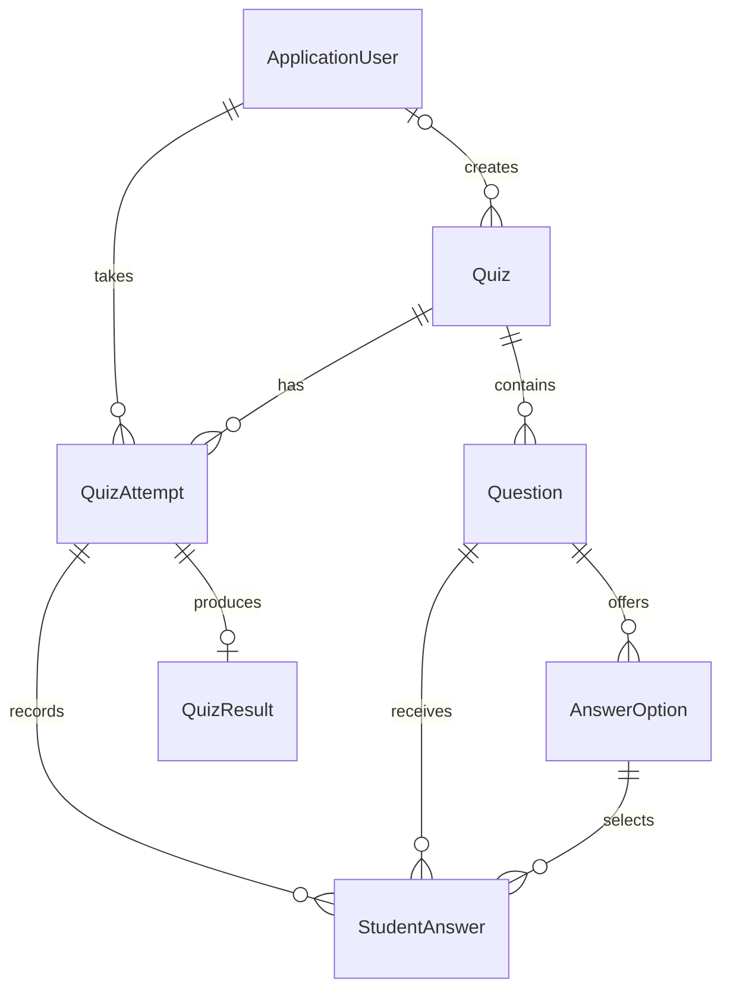

# QuizMaster

QuizMaster is a quiz management web application built as a .NET course project. Lecturers create and publish quizzes, students complete timed attempts, and administrators manage user roles. The application includes an ASP.NET Core API and an HTML, CSS, and JavaScript frontend served by the same web project.

## Features

- Registration, six-digit email verification through SMTP, and JWT login.
- Student, Lecturer, and Admin roles with authorization on API endpoints.
- Quiz, question, and answer-option management, with publishing and unpublishing.
- Single-choice, multiple-choice, and True/False questions. True/False questions use a fixed True/False answer pair.
- Timed student attempts, saved answers, answer-count progress, and attempt history.
- Automatic scoring, each participant's best result on the leaderboard, a vertical top-five score chart, and quiz statistics.
- User profiles, username updates, password changes, and profile-photo upload/removal.
- Quiz creator names and profile photos, with initials when a photo is unavailable.
- Responsive top navigation, a dashboard with quiz cards and recent attempts, dark/light themes, quiz search, and logout confirmation.
- DTO validation, entity property checks, database constraints, and exception handling with ProblemDetails responses and logging.

## Technologies

C# / .NET 10, ASP.NET Core Web API, ASP.NET Core Identity, JWT bearer authentication, Entity Framework Core, SQL Server, Swagger/OpenAPI, HTML, CSS, JavaScript, xUnit, Moq, and EF Core InMemory.

## Project structure

| Project | Responsibility |
| --- | --- |
| `QuizMasterDomain` | Entities, DTOs, enums, Identity user, and repository/storage interfaces |
| `QuizMasterApplication` | Business services and service interfaces |
| `QuizMasterInfrastructure` | SQL Server DbContext, migrations, repositories, unit of work, role seeding, and local file storage |
| `QuizMasterWeb` | API controllers, dependency registration, middleware, Swagger, and the frontend in `wwwroot` |
| `QuizMasterTest` | Domain, application-service, and repository tests |

## Roles

| Role | Main capabilities |
| --- | --- |
| Student | Take published quizzes, save and submit answers, view personal attempt history and leaderboards |
| Lecturer | Manage quizzes, questions, and answer options; publish/unpublish quizzes; view statistics and leaderboards |
| Admin | Manage quizzes and statistics, and change users' roles |

All signed-in users can manage their own profile, password, and photo. New registrations receive the Student role. Lecturer and Admin management access applies to all quizzes. Published quiz listings are also available through the public API.

## Run locally

### 1. Prerequisites

- .NET 10 SDK.
- Visual Studio with ASP.NET development tools and .NET 10 support.
- SQL Server, SQL Server Express, or LocalDB.
- An SMTP account for verification emails.

Clone or download the repository, open `QuizMaster.slnx`, restore NuGet packages, and set `QuizMasterWeb` as the startup project.

### 2. Configure local secrets

In Visual Studio, right-click **QuizMasterWeb → Manage User Secrets**. Merge the following settings into one JSON object, replacing the example values with your local configuration. User Secrets stores development settings outside the project directory. See [Microsoft's User Secrets documentation](https://learn.microsoft.com/en-us/aspnet/core/security/app-secrets?view=aspnetcore-10.0&tabs=visual-studio).

```json
{
  "ConnectionStrings": {
    "DefaultConnection": "Server=(localdb)\\MSSQLLocalDB;Database=QuizMasterDB;Trusted_Connection=True;TrustServerCertificate=True;"
  },
  "Jwt": {
    "Key": "REPLACE_WITH_YOUR_OWN_RANDOM_SIGNING_KEY",
    "Issuer": "QuizMasterApi",
    "Audience": "QuizMasterClient",
    "ExpirationInMinutes": "60"
  },
  "Email": {
    "Host": "smtp.gmail.com",
    "Port": "587",
    "SenderEmail": "your-email@gmail.com",
    "SenderPassword": "YOUR_GMAIL_APP_PASSWORD"
  }
}
```

Use your SQL Server instance in `DefaultConnection`. The email example uses Gmail SMTP with SSL/TLS and an app password. Keep the actual connection credentials, signing key, and email password in local configuration rather than in committed files.

To generate a random signing key, run this in PowerShell and copy the result into `Jwt:Key`:

```powershell
$keyBytes = New-Object byte[] 32
$generator = [System.Security.Cryptography.RandomNumberGenerator]::Create()
$generator.GetBytes($keyBytes)
[Convert]::ToBase64String($keyBytes)
$generator.Dispose()
```

### 3. Create/update the database

Open **Tools → NuGet Package Manager → Package Manager Console** and run:

```powershell
Update-Database -Project QuizMasterInfrastructure -StartupProject QuizMasterWeb
```

This applies the migrations included in the repository. Apply them before starting the application, because startup checks the role tables. See [Microsoft's EF Core migration instructions](https://learn.microsoft.com/en-us/ef/core/managing-schemas/migrations/applying?tabs=vs).

### 4. Start the application

Choose the **https** launch profile and press **Ctrl+F5** in Visual Studio. Alternatively, run this from the repository root:

```powershell
dotnet run --project QuizMasterWeb --launch-profile https
```

- Website: [https://localhost:7282/](https://localhost:7282/)
- Swagger: [https://localhost:7282/swagger](https://localhost:7282/swagger)
- Interface demo with sample data: [https://localhost:7282/?demo=1](https://localhost:7282/?demo=1)

Use the local HTTPS development certificate when prompted. The ports above come from the checked-in HTTPS launch profile; the console displays the active addresses. Swagger is enabled in the Development environment.

The demo keeps its sample data in memory and does not call the real quiz API. For actual use, register, verify the email code, and log in. In Swagger, use **Authorize** and paste the JWT returned by the login endpoint.

### 5. Set up the first admin

Startup creates the Student, Lecturer, and Admin role records. It does not create an administrator account or a default password.

For a fresh local database:

1. Start the application, register your administrator account, and verify its email.
2. In SQL Server Management Studio, select the database from your connection string.
3. Run the following script after replacing the email with that verified account's email. It assigns that account the Admin role.

```sql
DECLARE @Email nvarchar(256) = N'YOUR_VERIFIED_ADMIN_EMAIL';
DECLARE @UserId nvarchar(450) = (
    SELECT Id
    FROM dbo.AspNetUsers
    WHERE NormalizedEmail = UPPER(@Email) AND EmailConfirmed = 1
);
DECLARE @RoleId nvarchar(450) = (
    SELECT Id FROM dbo.AspNetRoles WHERE NormalizedName = N'ADMIN'
);

IF @UserId IS NULL OR @RoleId IS NULL
BEGIN
    THROW 50000, 'A verified user and the seeded Admin role must exist first.', 1;
END;

SET XACT_ABORT ON;
BEGIN TRANSACTION;
    DELETE FROM dbo.AspNetUserRoles WHERE UserId = @UserId;
    INSERT INTO dbo.AspNetUserRoles (UserId, RoleId)
    VALUES (@UserId, @RoleId);
COMMIT TRANSACTION;
```

4. Log in again to obtain a token containing the Admin role. Use the administration page or `PUT /api/admin/users/{userId}/role` for subsequent role changes.

## Tests

Tests are organized into `DomainTest`, `ApplicationTest`, and `InfrastructureTest`. The application tests use Moq; repository tests use EF Core InMemory. These repository tests do not exercise SQL Server-specific constraints.

Run them through Visual Studio's Test Explorer, or from the repository root:

```powershell
dotnet test QuizMasterTest/QuizMasterTest.csproj
```

## Database relationships

`ApplicationUser` is stored in `AspNetUsers`. The diagram shows the main quiz entities; ASP.NET Core Identity also supplies role, user-role, claim, login, and token tables.



A quiz's creator is optional for older records. Each saved selected option is represented by a StudentAnswer row. A quiz attempt can have at most one result.

## Behavior notes

- A question earns its full points when the selected answer IDs exactly match its correct answer IDs.
- The time limit is checked by the server. After expiry, answers cannot be changed; saved answers can still be submitted for scoring.
- Attempt history shows status and answer counts. Scores are returned on submission and used in the leaderboard and statistics.
- Existing attempt history prevents quiz deletion and question/answer-option changes. Published quizzes also lock question and option editing.
- Role changes are reflected in newly issued tokens. Log in again after changing an account's role. Logout clears the browser's session; already issued JWTs expire according to their configured lifetime.
- Profile photos accept JPG/JPEG/PNG files up to 2 MiB and are served from the public `/uploads/profiles/` directory with generated filenames.

## Remaining course requirement

List endpoints currently return the full collection. Server-side pagination remains to be added.
